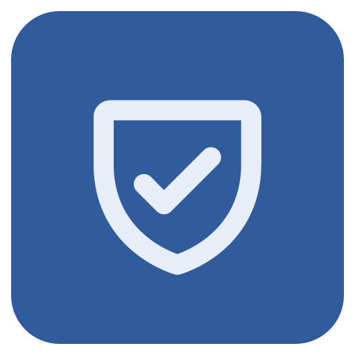
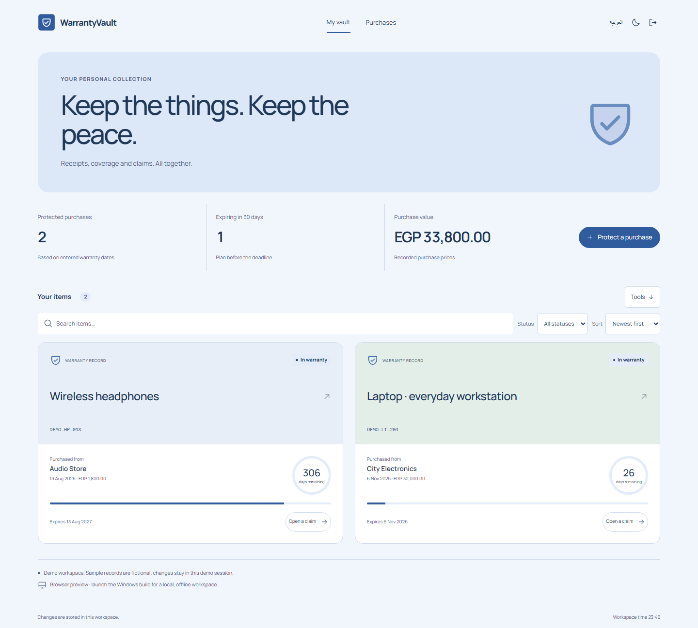
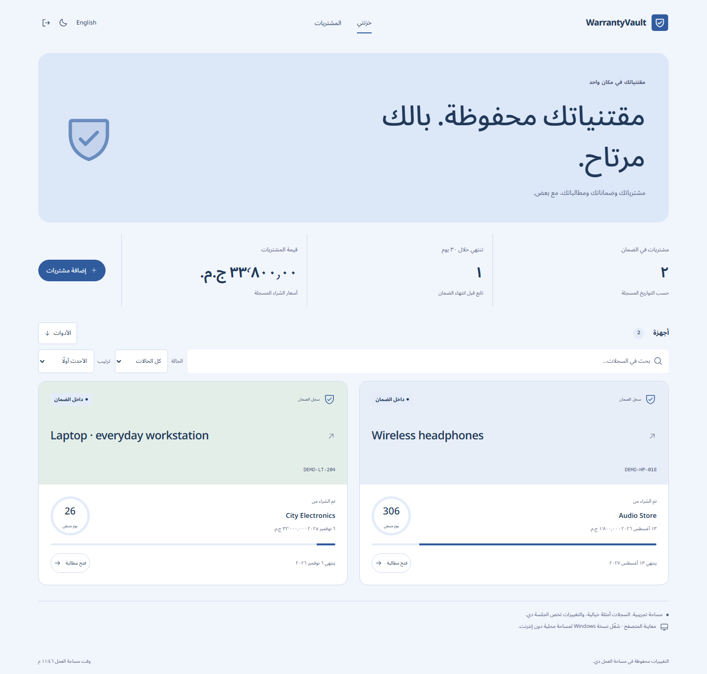
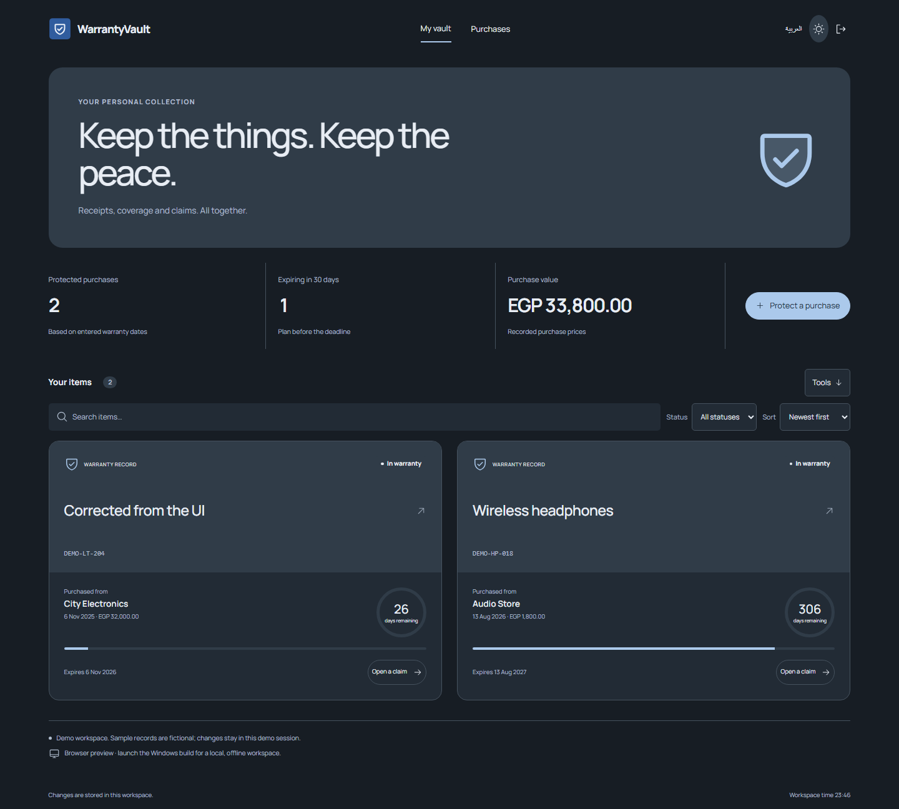

<div align="center">

<h1>WarrantyVault</h1>
<p>The details you need, when something stops working.</p>
</div>

**[Download for Windows](https://github.com/Ahmed-Khalil-Mohamed/warrantyvault/releases/latest)** · [العربية](#بالعربي) · [Report a bug](https://github.com/Ahmed-Khalil-Mohamed/warrantyvault/issues/new?template=bug_report.yml) · [Suggest an improvement](https://github.com/Ahmed-Khalil-Mohamed/warrantyvault/issues/new?template=feature_request.yml)



**Purchase → Coverage → Claim record**

For keeping purchase dates, coverage and claim progress together on your own computer.

[](https://github.com/Ahmed-Khalil-Mohamed/warrantyvault/actions/workflows/quality.yml) [](LICENSE) 

## Get the Windows app

Download **[WarrantyVault-1.1.0-windows-x64.zip](https://github.com/Ahmed-Khalil-Mohamed/warrantyvault/releases/download/v1.1.0/WarrantyVault-1.1.0-windows-x64.zip)**, extract the entire folder, and open `WarrantyVault\WarrantyVault.exe`. Keep the accompanying files next to the executable. Node.js is bundled; installing Node is only necessary for development.

[SHA256SUMS.txt](https://github.com/Ahmed-Khalil-Mohamed/warrantyvault/releases/download/v1.1.0/SHA256SUMS.txt) is supplied with the release. This is an **unsigned portable Windows x64 build**, tested on the development Windows machine; compatibility with every Windows configuration is not certified. There is no installer or automatic updater. Data stays in `%APPDATA%\WarrantyVault\workspace.sqlite`, separately from the browser preview. Copying the app folder does not copy that database.

GitHub's automatic source archives contain the complete development source; use the Windows ZIP to run the packaged application.

## A small passport for every purchase

1. Add a product, retailer, receipt reference, purchase date, warranty end and price.
2. Check items expiring within 30 days.
3. Open a claim with a reference, then resolve it with an outcome. Review the complete claim history.

## Behind the workflow

- Purchase dates and warranty ordering are validated.
- A product can have only one open claim at a time.
- Dates are user-entered coverage records, not an interpretation of statutory consumer rights.

## More of the interface

<details>
<summary>Arabic workspace / الواجهة العربية</summary>



</details>

<details>
<summary>Dark workspace</summary>



</details>

Airy blue collection space, rounded welcome panel, physical-item passports, serial numbers and circular coverage counters. Claims remain one action away from a purchase.

Screenshots show the actual interface with fictional demonstration records. [Design notes](DESIGN.md) · [Image and icon provenance](ASSETS.md).

## Build the desktop app

Use **Node.js 24 or newer** and npm.

```sh
git clone https://github.com/Ahmed-Khalil-Mohamed/warrantyvault.git
cd warrantyvault
npm ci
npm run build
npm run desktop
```

Package with `npm run package:windows`; the complete output is `release/WarrantyVault/`. The first launch or packaging step downloads the pinned Electron runtime, unless already cached. The packaged app runs offline.

Each checkout owns its dependency lockfile, server, tests and SQLite storage. The browser process uses `data/warrantyvault.sqlite` and the `warrantyvault_session` cookie. [Deployment and backups](docs/DEPLOYMENT.md).

## Checks you can run

```sh
npm run format:check
npm run check
npx playwright install chromium
npm run test:e2e
npm audit
```

Date ordering, future purchases, claim opening/resolution and duplicate-open-claim rejection. Local project results are in [VERIFICATION](docs/VERIFICATION.md).

The [Quality workflow](https://github.com/Ahmed-Khalil-Mohamed/warrantyvault/actions/workflows/quality.yml) runs on Windows and Linux. The badge above reports the live result. Local evidence, test counts and known validation limits are documented in [VERIFICATION](docs/VERIFICATION.md). Windows CI also packages the application and runs the native smoke check.

## Current boundaries

No receipt image storage/OCR, automatic notifications, retailer integration, or legal warranty advice. Record the existing receipt location in notes.

The sample records are fictional. Interview intended users and measure task completion before claiming proven impact. A useful next study is to compare the complete workflow with the person’s current spreadsheet or paper process.

## بالعربي

احفظ بيانات الشراء والأرقام التسلسلية ومواعيد الضمان ومتابعة المطالبات في قاعدة محلية.

بدّل اللغة من زر «العربية». البيانات التجريبية أمثلة وليست سجلات مستخدمين حقيقيين. [دليل التشغيل بالعربي](START-HERE-AR.md).

## Contribute and report

Use the [bug report](https://github.com/Ahmed-Khalil-Mohamed/warrantyvault/issues/new?template=bug_report.yml) for a reproducible problem, or the [feature request](https://github.com/Ahmed-Khalil-Mohamed/warrantyvault/issues/new?template=feature_request.yml) to explain a missing workflow. Reports in Arabic and English are welcome. Include the version, expected result and steps; use fictional records and redact personal data.

[Contribution guide](CONTRIBUTING.md) · [Private security reporting](SECURITY.md) · [Changelog](CHANGELOG.md) · [API](docs/API.md) · [Architecture](docs/ARCHITECTURE.md)

## License

[MIT](LICENSE). Third-party packages, fonts and icons retain their own licenses; see [THIRD-PARTY-NOTICES](THIRD-PARTY-NOTICES.md).
