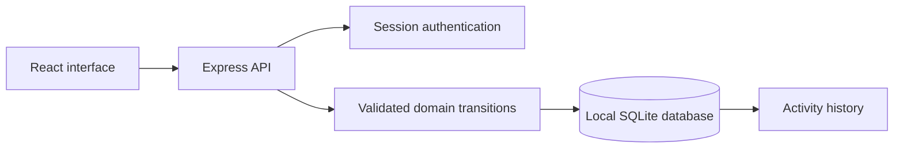

# WarrantyVault architecture

This repository runs independently. It has no imports, workspace dependencies, symlinks or services in another project folder.

## Boundaries

- `src/`: the interface, bilingual messages, product views and typed contracts.
- `apps/warrantyvault/domain.ts`: this application's fields, schemas, state machine and metrics.
- `server/app.ts`: authentication, request validation, origin protection and owner-scoped routes.
- `server/store.ts`: transactional persistence, activity events and version checks.
- `tests/`: domain, HTTP, persistence, edit-safety and browser tests.

## Data ownership

The browser server stores data in `data/warrantyvault.sqlite`. `DATA_DIR` changes the directory. Each record belongs to an account. Reads, edits, actions and deletion check ownership. The session cookie is named `warrantyvault_session`, so other local portfolio apps do not replace it.

SQLite uses WAL mode, foreign keys, a busy timeout and immediate write transactions. State-changing requests carry the current record version; a stale write returns HTTP 409. Description edits only accept the fields in `src/editing.ts`. They cannot rewrite balances, inventory quantities, workflow status or transaction history.

Amounts use integer minor units. Dates are validated, and transactional rules run on the server. Client-side validation supports input; it is not the trust boundary.

## Authentication

Passwords use salted scrypt. Random session tokens are hashed in storage, sent in HttpOnly SameSite=Strict cookies, and expire after 24 hours. Mutation requests require the application's request header and a matching Origin when supplied. Configure HTTPS and secure cookies for public deployment. Account recovery, MFA, collaboration roles and email verification are outside this release.

## Interface

The interface supports Arabic RTL, English, light and dark themes, keyboard dialogs, status filtering, sorting, search, CSV export and JSON snapshots. The JSON download is an inspection/export format; this release does not implement import or restore through the interface. An offline database backup must include all SQLite files after shutting down the process.

The UI uses the local `src/product.css` rules and the application-specific view in `src/product-views.tsx`. There is no project switcher or shared account service.

## Windows boundary

Electron serves the bundled interface on a private loopback port. The main process attaches a random token; calls without it are rejected. Context isolation, sandboxing, disabled Node integration, navigation restrictions and denied external windows limit renderer privileges. Only one instance of WarrantyVault can open its local workspace at a time.

Windows data and browser profile are in `%APPDATA%\WarrantyVault`. The database is `workspace.sqlite`. It is separate from the browser-preview database. Local files are not encrypted by the application. Native builds are portable and unsigned.
